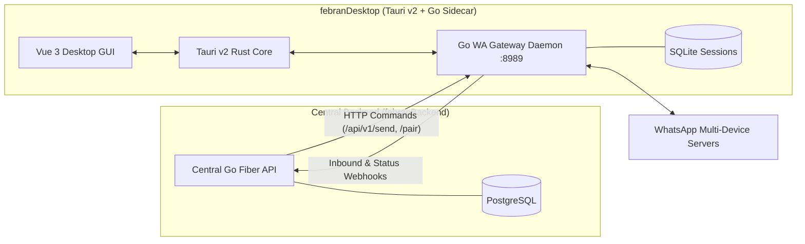

# Febran WA Gateway Desktop

Dedicated Desktop Application & WA Gateway transport node for the **febran** platform.

Combines a **pure-Go high-performance WhatsApp daemon** (`whatsmeow` + SQLite per device) with a **Tauri v2 + Vue 3 desktop GUI** for local session management, live QR code pairing, message dispatch sandbox, and real-time streaming console logs.

---

## 🏗️ Architecture



---

## ✨ Features

- **Tauri v2 Desktop GUI**: Native lightweight desktop application with hardware-accelerated WebView2.
- **Go Daemon Sidecar**: Pure-Go WhatsApp Multi-Device transport layer with SQLite storage per number (no CGO required).
- **Interactive QR Pairing**: Live countdown QR code generator with auto-refresh and instructions for mobile WhatsApp linking.
- **Message Sandbox**: Test direct messages or group chats with instant delivery feedback.
- **Live Streaming Console**: Real-time stdout/stderr log terminal with search filter, auto-scroll, and clipboard copy.
- **Central Webhook Relay**: Automatically delivers `message.inbound` and `status.changed` events to `febranBackend` with exponential backoff retry.
- **Zero-CGO Pure Go**: Runs seamlessly across Windows x64 and Linux.

---

## 🚀 Getting Started

### 1. Prerequisites
- **Node.js**: v18+ & **pnpm** (or npm)
- **Go**: 1.24+
- **Rust & Cargo**: 1.75+ (for Tauri v2)

### 2. Install Dependencies
```bash
# Install frontend & Tauri dependencies
pnpm install

# Compile the Go Gateway sidecar binary
npm run build:sidecar
```

### 3. Run in Development Mode
```bash
# Starts both Vite frontend and Tauri desktop window
pnpm run tauri:dev
```

### 4. Build Production Executable / Installer
```bash
pnpm run tauri:build
```
The output `.msi` and `.exe` bundles will be created in `src-tauri/target/release/bundle/`.

---

## ⚙️ Configuration (`.env`)

| Key | Default | Description |
|-----|---------|-------------|
| `GATEWAY_BIND` | `127.0.0.1:8989` | Local IP and port for the gateway HTTP server |
| `GATEWAY_API_KEY` | `dev-gateway-key-2024` | Secret key validated via `X-Gateway-Key` header |
| `CENTRAL_WEBHOOK_URL` | `http://localhost:8080/api/v1/webhooks/gateway` | Webhook endpoint on `febranBackend` |
| `CENTRAL_API_KEY` | `dev-central-key-2024` | Secret key forwarded to central backend in webhooks |
| `SESSION_DIR` | `./sessions` | Local directory for storing SQLite session files |
| `LOG_LEVEL` | `info` | Daemon log level (`debug`, `info`, `warn`, `error`) |

---

## 📁 Project Structure

```
febranDesktop/
├── cmd/gateway/                   # Pure-Go WA Gateway entrypoint (main.go + Windows service files)
├── pkg/whatsapp/
│   ├── session.go                 # whatsmeow session manager & SQLite store
│   └── types.go                   # Shared event types
├── internal/
│   ├── config/                    # Config loader & validator
│   ├── handler/                   # Fiber HTTP handlers (pair, qr, send, etc.)
│   ├── middleware/                # X-Gateway-Key authentication
│   ├── router/                    # Route registration
│   └── webhook/                   # Async webhook client with 3x retry
├── src-tauri/
│   ├── src/lib.rs                 # Tauri Rust backend & daemon lifecycle manager
│   ├── src/main.rs                # Windows subsystem entrypoint
│   ├── binaries/                  # Compiled Go sidecar binary
│   ├── capabilities/              # Tauri v2 security capabilities
│   └── tauri.conf.json            # Tauri v2 configuration
├── src/                           # Vue 3 Frontend UI
│   ├── components/                # Dashboard, Sessions & QR, Sandbox, Logs, Settings
│   ├── api.ts                     # Tauri IPC & Gateway HTTP client
│   ├── App.vue                    # Root application component
│   └── style.css                  # Dark-theme design tokens
├── scripts/build-sidecar.ps1      # Automated sidecar Go compiler
└── package.json                   # Scripts & dependencies
```
