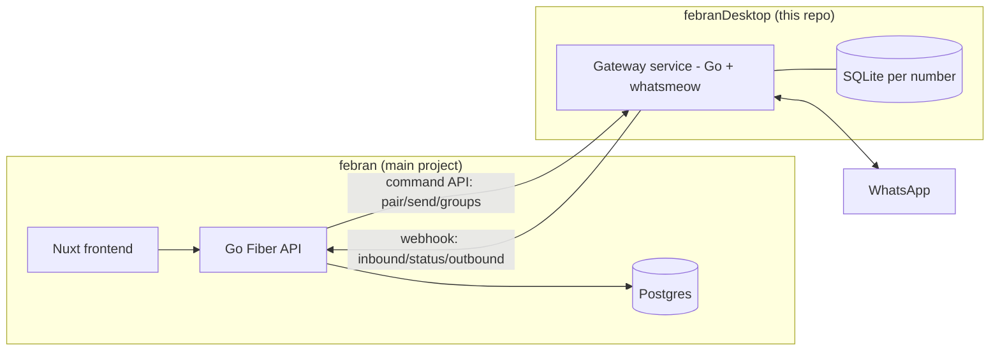

# WA Gateway Backend (febranDesktop)

Dedicated Go service that owns WhatsApp sessions (whatsmeow) for the main `febran` project.

**Not** a Tauri desktop app. **Not** a client-PC "Device ID Pairing" gateway. That framing (desktop sidecar, `window.__TAURI__`, local `127.0.0.1` token, SmartScreen signing) was for a different client ("kaffah") and is dropped.

This repo is the **gateway transport layer** — a server-side daemon the `febran` API delegates WhatsApp send/receive/pairing to.

---

## 1. Why a separate service

The main project `febran` (`D:\data\devapp\febran`) is a full-stack app: Nuxt 4 frontend + Go Fiber API + Postgres + RabbitMQ. It currently runs the whatsmeow `Manager` **inline** in `pkg/whatsapp/session.go`.

Extracting the gateway into this repo gives:

- **Independent scaling** — WhatsApp sessions are stateful (one long-lived socket per number); they shouldn't scale with the stateless API.
- **Failure isolation** — a session crash / WhatsApp reconnect storm shouldn't take down the API.
- **Deployment isolation** — gateway runs where WhatsApp won't flag datacenter IPs, API runs anywhere.

## 2. Architecture

- **Gateway → Central**: HTTP webhooks (`message.inbound`, `status.changed`, `message.sent`, `message.failed`).
- **Central → Gateway**: HTTP command API (`pair`, `send`, `send-group`, `groups`, `logout`).
- **Auth**: Gateway API Key, per tenant/number. Request/response over private network; WebSocket push is a later phase, not MVP.

## 3. Reuse (do not rewrite)

Port `pkg/whatsapp/session.go` from `febran` as-is. It already provides:

`StartPairing`, `GetQR`, `IsConnected`, `SendText`, `SendGroupText`, `ListGroups`, `GetGroupMembers`, `Stop`, `RecoverConnected`

Facts verified against `febran` code:

| Item | Reality |
|------|---------|
| Session storage | One SQLite per number (`<numberID>.db`), driver `modernc.org/sqlite` (pure Go, no cgo) |
| QR pairing | `whatsmeow.GetQRChannel`, QR encoded to data-URL PNG |
| Inbound | `events.Message` handler extracts text/caption only; media is future work |
| Reconnect | `RecoverConnected` scans session dir and re-connects saved sessions |

## 4. Coupling points in `febran` that must change

1. **Inbound ingestion** is a closure inline in `cmd/server/main.go:80-153` writing straight to Postgres. Extract to `service.IngestService` so both the in-process callback (legacy) and the gateway webhook handler share it.
2. **`WANumber`** needs a `GatewayMode` field (`central` | `gateway`) + `GatewayLastSeenAt`.
3. **`MessageService.Send`** must route `gateway`-mode numbers to the gateway command API instead of the local session.
4. **Gateway API key auth** — entity `APIKey` + CRUD exist, but there's no middleware validating `X-Gateway-Key`. Add one.
5. **Webhook receiver** — add `POST /api/v1/webhooks/gateway` in `febran`, calling `IngestService` + updating `WANumber.Status`.
6. **`Manager.Stop`** deletes the session DB (re-pair from scratch). Add `Stop(keepSession bool)` so disconnect ≠ full re-pair.

## 5. Implementation phases

### Phase 0 — `febran` prep (no behavior change)
- [ ] Extract inbound ingestion → `service.IngestService`
- [ ] Add `GatewayMode` + `GatewayLastSeenAt` to `WANumber` + auto-migrate
- [ ] Add Gateway API-key middleware (`X-Gateway-Key` → tenant/number)
- [ ] Add `Manager.Stop(keepSession bool)`

### Phase 1 — this repo (gateway service)
- [ ] `go.mod` (module `github.com/algofran/febranDesktop`), port `pkg/whatsapp`
- [ ] `cmd/gateway/main.go`: HTTP server, bind from `GATEWAY_BIND` (default `0.0.0.0:8989`), token auth
- [ ] Endpoints: `POST /pair`, `GET /qr/:id`, `GET /status/:id`, `POST /send`, `POST /send-group`, `GET /groups/:id`, `POST /logout/:id`, `GET /health`
- [ ] Webhook client → `CENTRAL_WEBHOOK_URL` + `X-Gateway-Key`; retry + backoff
- [ ] Auto-reconnect via `RecoverConnected` on boot
- [ ] `Dockerfile` + `.env.example`

### Phase 2 — `febran` wiring
- [ ] `MessageService.Send` routes `gateway` numbers → gateway API
- [ ] `NumbersView.vue` QR flow branches to gateway for `gateway`-mode numbers
- [ ] Status + inbound refresh from webhook + short poll

### Phase 3 — verify
- [ ] Pair a number through the gateway, scan QR, status `connected` in `febran`
- [ ] Send/receive end-to-end; message recorded in Postgres via webhook
- [ ] Gateway restart → `RecoverConnected` without re-scan

## 6. Deferred (out of MVP)

- WebSocket push central → gateway (auto-reply/broadcast)
- Media messages (send/receive)
- SSE/WS real-time to frontend
- Multi-tenant gateway sharding / horizontal session fan-out
