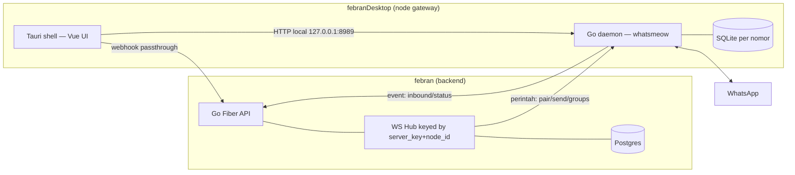

# WA Gateway Node (febranDesktop)

Desktop app + Go sidecar daemon yang menjalankan sesi WhatsApp (whatsmeow) untuk backend `febran`.

- **Bukan** server-side daemon standalone, **bukan** klien pairing "Device ID" client-PC (framing lama "kaffah" — dibuang).
- Bentuk nyata: **aplikasi Tauri desktop** (shell Vue) yang menjalankan **daemon Go** (`gateway`) sebagai sidecar. Daemon memegang sesi WhatsApp dan tersambung ke backend `febran` via **WebSocket** untuk menerima perintah dan melapor status.

---

## 1. Arsitektur

Peran tiap lapisan:

| Lapisan | Teknologi | Peran |
|---|---|---|
| Shell | Tauri + Vue (tab: Dashboard, Sessions, Sandbox, Logs, Settings) | start/stop/restart daemon, baca status & log, simpan konfigurasi `.env` |
| Daemon | Go (Fiber + whatsmeow) | pegang sesi WhatsApp, sediakan HTTP lokal, jembatan ke backend |
| Backend | `febran` Go Fiber + Postgres | hub WS, routing perintah ke node, simpan pesan/status |

## 2. Fitur & status (diverifikasi terhadap kode)

| Fitur | Didukung | Bukti |
|---|---|---|
| Tauri shell: start/stop/restart daemon | ✅ | `src-tauri/src/lib.rs` (start/stop gateway, status, log stream) |
| Konfigurasi 8 env var via UI Settings | ✅ | `SettingsView.vue` → `save_config` → tulis `.env` + spawn ulang |
| Sesi WhatsApp per nomor (SQLite, pure Go) | ✅ | `pkg/whatsapp`, driver `modernc.org/sqlite`, `<numberID>.db` |
| Auto-reconnect sesi saat daemon boot | ✅ | `RecoverConnected()` di `cmd/gateway/main.go` |
| Pairing QR | ✅ | `StartPairing` + `GetQR` (data-URL PNG) |
| Pairing kode 8-digit | ✅ | `PairWithCode` via `pair_code` |
| Kirim pesan teks | ✅ | `SendMessage` (strip `+`) |
| Kirim pesan grup | ✅ | `SendGroupMessage` |
| Daftar grup + anggota | ✅ | `ListGroups`, `GetGroupMembers` |
| Logout / disconnect sesi | ✅ | `Stop` (hapus DB vs simpan) |
| Daftar perintah WS dari backend | ✅ | `pair_qr`, `pair_code`, `send`, `send_group`, `list_groups`, `group_members_req`, `disconnect` |
| Event WS ke backend | ✅ | `hello` (device report), `device_update` |
| Webhook event ke backend | ✅ | `message.inbound`, `status.changed` |
| Anti-duplikat server_key | ✅ | `node_id` persisten; backend tolak `server_key` yang dipakai node lain (close 4000) |
| HTTP lokal (dipakai shell/tes) | ✅ | `/health`, `/api/v1/{sessions,pair,pair-qr,qr/:id,status/:id,send,send-group,groups/:id,logout/:id}` |

## 3. Protokol

### Node → Central (WebSocket)
`GET {CENTRAL_WS_URL}?server_key=…&node_id=…&key=…` — register ke hub backend.

- **server_key** — identitas node di backend; wajib unik, match dengan `server_key` tersimpan di nomor (tenant).
- **node_id** — identitas persisten mesin (`<session_dir>/node_id`, dibuat saat pertama jalan). Membedakan reconnect sah (node sama) dari node kedua yang memakai key sama.
- Duplikat key dari node berbeda → backend tutup koneksi, kode close **4000**, node menampilkan log "server_key already in use by ANOTHER node".

### Central → Node (perintah)
Request/reply sinkron via ReqID: `pair_qr`, `pair_code`, `send`, `send_group`, `list_groups`, `group_members_req`, `disconnect`.

### Node → Central (event)
- Webhook HTTP: `message.inbound`, `status.changed`.
- WS: `hello` (dilaporkan saat konek, berisi status semua sesi), `device_update` (perubahan pairing).

## 4. Perintah lokal (Tauri shell → daemon)

Dilindungi `GATEWAY_API_KEY` (header `X-Gateway-Key`). Dipakai shell untuk menampilkan status/sesi dan fitur Sandbox. Bukan API untuk backend — backend bicara lewat WS.

## 5. Non-goal (dibuang / deferred)

| Item | Status |
|---|---|
| Framing "client-PC Device ID pairing" (kaffah) | Dibuang |
| HTTP command API central → node | Dibuang — diganti WS hub |
| Daemon sebagai container Docker | Non-goal — distribusi adalah desktop sidecar (`src-tauri/binaries/`) |
| Media messages (kirim/terima) | Deferred |
| Real-time SSE/WS ke frontend web `febran` | Deferred |
| Sharding multi-node / horizontal session fan-out | Deferred |

## 6. Roadmap

- [ ] Auto-daftar node ke backend (`POST /gateway-nodes` dengan `server_key` + nama) — saat ini `server_key` diinput manual di Settings dan harus cocok dengan yang didaftarkan di backend.
- [ ] Heartbeat / `GatewayLastSeenAt` agar backend tahu node offline.
- [ ] Webhook retry + backoff eksplisit.
- [ ] Media messages (fase lanjut).
